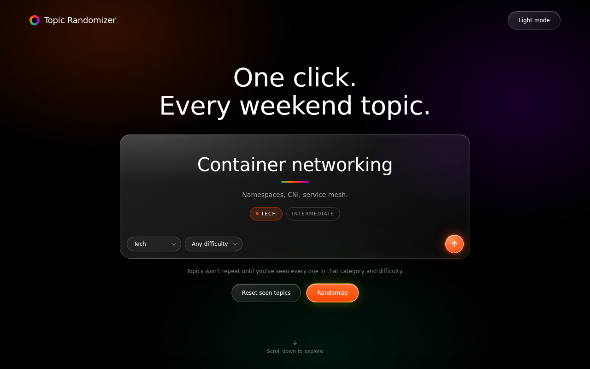
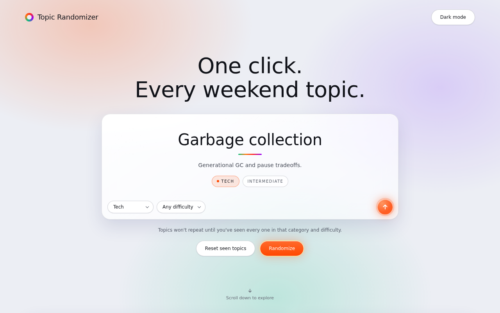

# Topic Randomizer

A single-file web app that picks a random topic for you to study each weekend, so you can practice explaining it clearly. Choose a category, optionally a difficulty, and hit the arrow.

No install, no build step, no backend. Open the HTML file and it works.





## Features

- **201 built-in topics** across 8 categories: Tech, Non-Tech, Business, Finance, Science, History, Philosophy and Health
- **Category and difficulty filters** (Beginner, Intermediate, Advanced), plus a **Surprise Me** option that picks a category for you
- **No repeats**: a topic isn't shown again until you've seen every topic in that category and difficulty
- **Weekend Pair**: one Tech topic plus one from a category you choose
- **History** of your last 10 picks, with a "done" checkbox on each, and a **Clear history** button with Undo
- **Add your own topics** with a category, name, one-line description and difficulty
- **Light and dark mode**, which follows your system setting and remembers your choice
- **Liquid-glass design**: frosted panels, soft glows and pill-shaped controls, responsive down to phone screens
- Keyboard accessible, with visible focus states, and the shuffle animation is skipped if you prefer reduced motion

## Getting started

1. Download `topic-randomizer.html` (or clone this repo).
2. Double-click it to open it in your browser.

That's it.

## How to use it

1. Pick a **category** and a **difficulty** in the pills at the bottom of the panel.
2. Click the orange arrow (or the **Randomize** button) to get a topic.
3. Study it, then try explaining it out loud in five minutes with no notes.
4. Tick the topic off in **History** when you're done.
5. Use **Reset seen topics** if you want every topic back in the pool.

## Add or edit topics

Built-in topics live in the `TOPICS` object near the top of the script in the HTML file. Each category is a list of topics in this shape:

```js
{ name: "Embeddings and vector search",
  desc: "How semantic similarity is stored and queried.",
  difficulty: "Intermediate" }
```

- `difficulty` must be `Beginner`, `Intermediate` or `Advanced`.
- To add a category, add a new key to `TOPICS` with a list of topics. It appears in every dropdown automatically.

Topics you add through the form in the app are saved separately in your browser and join the pool.

## Where your data is stored

Everything you create is saved in your browser's `localStorage`, under keys that start with `topicRandomizer_`:

| Key | What it holds |
|---|---|
| `topicRandomizer_custom` | Topics you added |
| `topicRandomizer_history` | Your recent picks and their done state |
| `topicRandomizer_seen` | Which topics you've already been shown |
| `topicRandomizer_theme` | Light or dark preference |

This means your data stays on that browser and device. It won't sync to another device, and clearing your browser's site data will delete it. To keep a topic permanently, add it to the `TOPICS` object in the file.

## Tech

- HTML, CSS and vanilla JavaScript in one file, with no frameworks and no dependencies
- Fonts: [Inter](https://fonts.google.com/specimen/Inter) and [Space Grotesk](https://fonts.google.com/specimen/Space+Grotesk) from Google Fonts. If they can't load, system fonts are used, so the app still works offline.
- Glass effect uses `backdrop-filter`. In very old browsers the panels fall back to plain translucent surfaces.